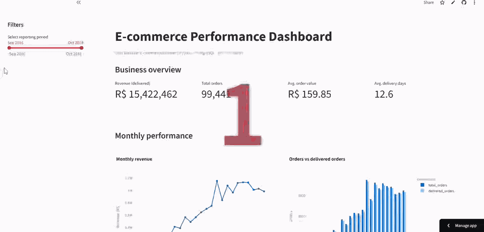

# E-commerce Analytics Engineering | Olist

An end-to-end analytics engineering portfolio project demonstrating **Python ingestion → Supabase PostgreSQL → dbt modeling & data quality tests → Streamlit/Plotly dashboard**.

## 📊 Interactive Dashboard Preview

[](https://ecommerce-analytics-engineering-gtqt8wgxlrn4nyxmcttjum.streamlit.app/)

**[🚀 Explore the Live Interactive Dashboard](https://ecommerce-analytics-engineering-gtqt8wgxlrn4nyxmcttjum.streamlit.app/)**

*Click the animated dashboard preview to explore the fully interactive version.*

## What it demonstrates

- 5 original Olist datasets ingested into PostgreSQL (`raw` schema)
- 5 staging views with 13 data quality tests
- 2 fact tables (`fct_orders`, `fct_order_items`) and 2 dimension tables (`dim_customers`, `dim_products`)
- Monthly KPI mart (revenue, orders, AOV, delivery performance)
- Interactive charts for reporting period and product category


### Project structure

```text
notebooks/
  01_raw_data_ingestion.ipynb
  02_dbt_staging.ipynb
  03_dbt_marts.ipynb
  04_dashboard_data_export.ipynb
models/
  staging/                # sources, SQL views, dbt tests
  marts/                  # facts, dimensions, KPI mart, tests
dbt_project.yml
olist_dashboard/           # already deployed Streamlit app; preserve existing folder
  app.py
  requirements.txt
  data/
    monthly_sales.csv
    monthly_categories.csv
```

## Run in Google Colab

Notebooks must be **opened** in Colab (File → Open notebook → GitHub or Upload), not merely uploaded into the runtime Files sidebar.

| Order | Notebook | Purpose |
|---|---|---|
| 1 | [Raw ingestion](notebooks/01_raw_data_ingestion.ipynb) | Safe create-if-missing ingestion; skips existing tables |
| 2 | [dbt staging](notebooks/02_dbt_staging.ipynb) | Compile/build 5 staging models and tests |
| 3 | [dbt marts](notebooks/03_dbt_marts.ipynb) | Build facts, dimensions and KPI mart |
| 4 | [Dashboard export](notebooks/04_dashboard_data_export.ipynb) | Generate aggregated dashboard CSVs |

**[Open notebook 01 in Colab](https://colab.research.google.com/github/farnazsharbafi/ecommerce-analytics-engineering/blob/main/notebooks/01_raw_data_ingestion.ipynb)** · **[02](https://colab.research.google.com/github/farnazsharbafi/ecommerce-analytics-engineering/blob/main/notebooks/02_dbt_staging.ipynb)** · **[03](https://colab.research.google.com/github/farnazsharbafi/ecommerce-analytics-engineering/blob/main/notebooks/03_dbt_marts.ipynb)** · **[04](https://colab.research.google.com/github/farnazsharbafi/ecommerce-analytics-engineering/blob/main/notebooks/04_dashboard_data_export.ipynb)**

**Prerequisites:** a Supabase PostgreSQL database and a private Session-pooler URI, the 5 Olist CSVs for a fresh database, and the dbt project files already pushed to this repository. SQL notebooks use `dbt_dev` as the development schema. Run each notebook from top to bottom. Colab runtimes are temporary.

The notebooks are *not* executed by GitHub itself. GitHub displays them; Colab runs them. All original transaction data is historical. Dashboard files are exported aggregates, so visitors do not need access to private Supabase credentials.

**Security:** Never publish `profiles.yml`, secrets, database URLs or raw person-level CSVs. The project's `.gitignore` excludes these. Check notebook output before committing.

**Note on metrics:** order-level revenue uses recorded payments on delivered orders (potentially including freight); category revenue uses item prices excluding freight. Historical metrics are grouped by purchase month; they are not real-time sales.

## Data source

[Olist Brazilian E-Commerce Public Dataset](https://www.kaggle.com/datasets/olistbr/brazilian-ecommerce) — historical transactions used solely for portfolio analysis.
